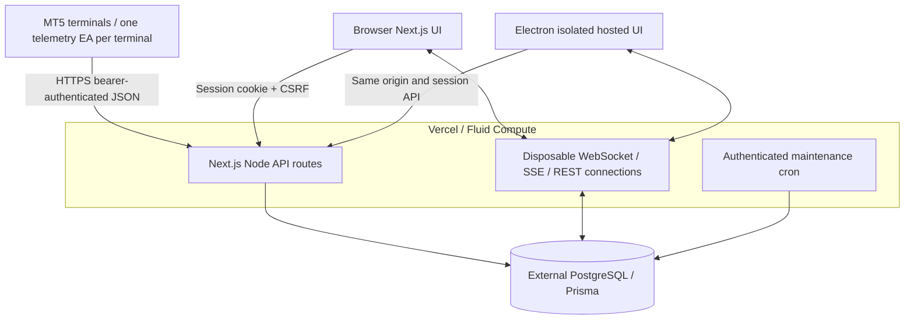
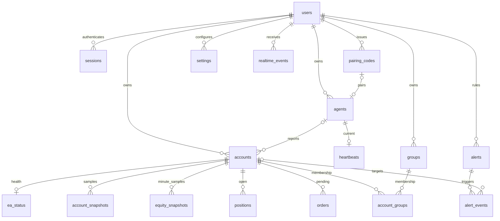

# Architecture

`app/api/**/route.ts` exposes handlers implemented in `api/`. `server/agent` ingests telemetry and evaluates alerts; `lib/queries` projects persisted state; `lib/realtime` consumes the event log. Electron packages contain only the shell, resources, and required runtime modules; no backend database or credentials. Local embedded PostgreSQL and the standalone WebSocket server are development tools only.

## Database

`rate_limits` is additional infrastructure keyed by bucket/window. Account identity is `(userId, login, server)`; ticket uniqueness is `(accountId, ticket)`. Tickets and magic values are decimal strings, preserving 64-bit identifiers. User/session, credential and pairing hashes remain server-side.

Account snapshots are collected at reporting frequency, equity samples at most once per minute. Account rows retain current state, lifetime sampled peak and maximum drawdown. Financial storage uses double precision, appropriate for monitoring but not a broker settlement ledger. Calculations use reported account currency. Cross-currency totals are omitted unless a currency filter is applied; no exchange rate feed exists.

Realtime events are invalidation hints. Clients fetch authoritative REST state on reconnect and periodically; a gap or pruned event history cannot erase current state. PostgreSQL NOTIFY is best-effort only. Stream state is disposable and expires before Vercel's function duration. Session revocation is periodically rechecked on active connections.

## Capacity and semantics

- No performance claim for 500 terminals without a representative load/soak test. Every report writes PostgreSQL, so connection pooling and retention matter.
- Account drawdown is based on sampled equity. Deposits/withdrawals affect equity peaks; the metric is not cash-flow-adjusted investment performance.
- Aggregate equity uses last observation carried forward. Disconnected accounts retain stale last-known equity and must be reviewed using status/last-seen.
- Snapshot retention does not reset lifetime peak/max drawdown. Realtime events retain seven days; expired sessions, pairing codes and rate buckets are removed.
- Export limits: positions/orders 50,000 records per request. Trade history is not collected.
- The API role hierarchy enforces OWNER > ADMIN > VIEWER. Each signup owns an isolated fleet. There is no organization-sharing/invitation feature.
